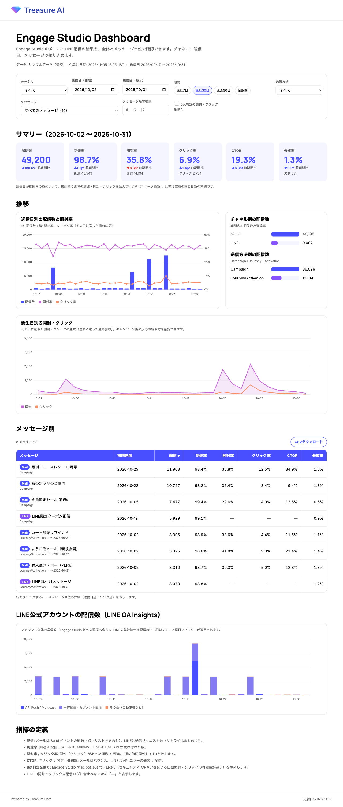
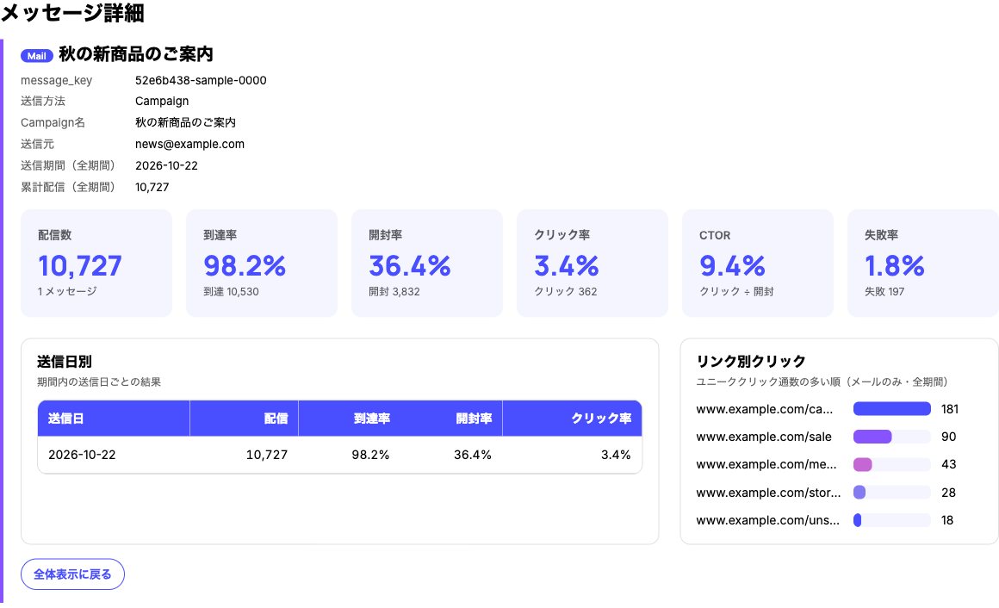
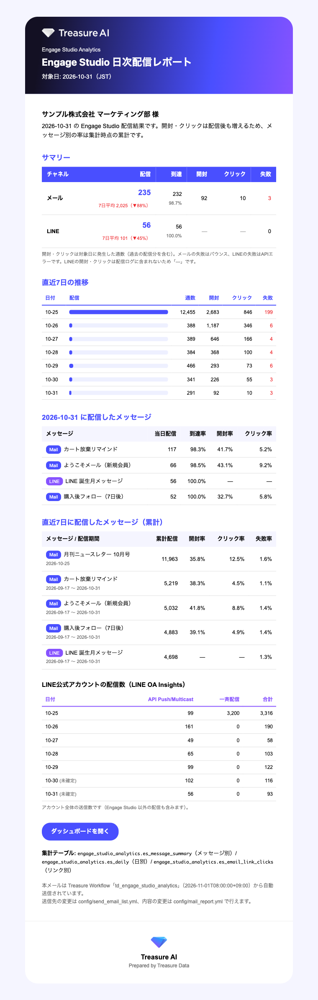

# td-engage-studio-analytics-builder

Engage Studio（メール / LINE）の配信結果を、**全体**と**メッセージ単位**で集計する Treasure Workflow を構築する Treasure Work / Treasure AI Studio 向け Skill です。
集計テーブルに加えて、Treasure AI ブランドの **HTML ダッシュボード**（チャネル・期間・メッセージで絞り込み）と、WF から送る **日次 HTML メールレポート** を作ります。

## サンプル

画像はすべて架空のサンプルデータです。

### ダッシュボード



メッセージ一覧の行をクリックすると、メッセージ単位の詳細（送信日別・リンク別クリック）を表示します。



### 日次メールレポート



## できること

- `delivery_email_*` / `delivery_line_*` を読み取り専用で調べ、**ドキュメントと実データの列の違い**を確認してから設定する
  - メールの `time` は送信時刻（開封・クリックは数週間後に送信時刻のパーティションへ届く）→ 直近 `lookback_days` 日を毎回作り直す
  - `campaign_id`（Campaign 機能）と `custom_event_id`（Journey / Activation）をメッセージ単位のキーにする（件名は差し込みで変わるため使わない）
  - `test_mode`（varchar）、`is_bot_event`（Bot 判定の開封・クリック除外）、`error_events` の有無
- **LINE を配信しているかを毎回確認**。配信ログ（`auto_log` / `event_log` の2形式）から送信・到達・失敗を集計
- LINE の開封・クリックは配信ログにないため、必要なら **LINE OA Insights** の取り込みを案内（制約も説明）
- 共通テーブル `message_summary`（メッセージ別累計）/ `send_cohort`（送信日 × メッセージ）/ `daily`（発生日 × メッセージ）
- ダッシュボード: KPI（前期間比較）、送信日別の配信数と開封率、発生日別の開封・クリック、チャネル別・送信方法別、メッセージ一覧（並べ替え・CSV）、メッセージ詳細、LINE OA Insights
- 日次メール: 前日のチャネル別 KPI（7日平均比較）、7日推移、前日配信分、直近7日の累計結果。HTML は WF 内の Trino で組み立てて `mail>` で送信（`py>` 不使用）
- テスト送信用 WF（`send_test_mail.dig`）で、本番宛先の前に表示を確認

## 同梱物

```text
td-engage-studio-analytics-builder/
├── SKILL.md                         # 読込の入口
├── README.md
├── marketplace-entry.json
└── templates/project/               # Workflow テンプレート（顧客ごとにコピーして使う）
    ├── td_engage_studio_analytics.dig
    ├── send_test_mail.dig
    ├── sub_error.dig
    ├── config/                      # common / email / line / mail_report / 宛先
    ├── queries/                     # setup / email / line / unified / mail
    ├── templates/                   # 日次メール HTML・ロゴ
    ├── dashboard/                   # template.html・build_dashboard.py・取得クエリ
    └── docs/                        # 列の確認結果・出力テーブル・LINE・メール・ダッシュボード・キャプチャ
```

詳しい構成と指標の定義は [templates/project/README.md](templates/project/README.md) を参照してください。

## インストール

### Treasure Work（グローバルスキル）

```bash
cp -r td-engage-studio-analytics-builder ~/.treasure-work/.claude/skills/
```

### Treasure Work（ワークスペーススキル）

```bash
cp -r td-engage-studio-analytics-builder /path/to/workspace/.claude/skills/
```

コピー後、Treasure Work を再起動するとスキルが認識されます。

## 使い方

```text
/td-engage-studio-analytics-builder
```

または次のように依頼します。

```text
Engage Studio のメール配信結果を、全体とメッセージ別に集計するWFを作りたい。
LINEも配信しているか確認して、毎朝の日次メールレポートも送りたい。
```

## 注意

- 集計WFの初回実行・テスト送信・本番メール送信は、内容と宛先を確認してから実行します（`--dry-run` で説明し、承認を得てから）。
- LINE のチャネルアクセストークンなどの認証情報は、チャットに貼らず、お客様自身が Integration Hub / Workflow Secrets に登録します。
- ダッシュボードの HTML にはメッセージ名（件名）が入ります。件名に個人名・企業名が差し込まれる場合は共有範囲に注意し、`message_names` で表示名を付けてください。

## ライセンス

MIT
