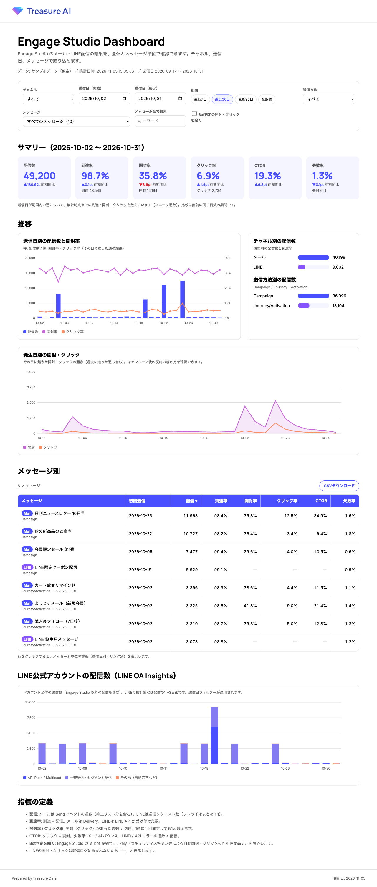
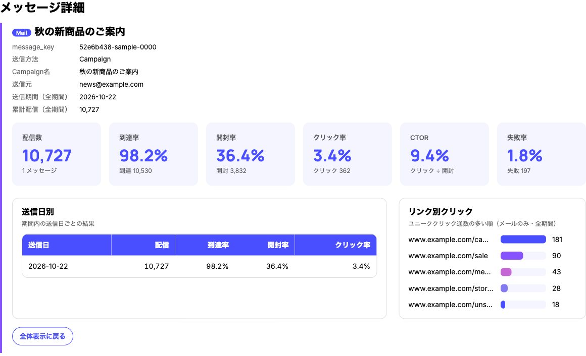
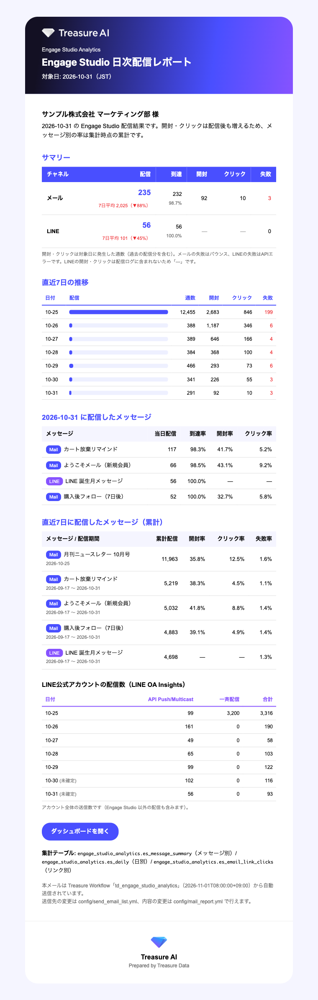

# TD Engage Studio Analytics

Treasure Data **Engage Studio** の配信結果（メール / LINE）を集計し、
**全体のレポート**と**メッセージ単位のレポート**を作る Treasure Workflow（Digdag）パッケージです。

- メール: 送信・到達・開封・クリック・バウンス・苦情・送信失敗を、1通単位 → メッセージ別 / 日別 / リンク別に集計
- LINE: 配信ログから送信・到達・失敗をメッセージ別 / 日別に集計。LINE OA Insights（任意）でアカウント全体の配信数も表示
- ダッシュボード: Treasure AI ブランドの HTML（チャネル・期間・メッセージで絞り込み）
- 日次メールレポート: 前日の配信結果を HTML メールで送信（任意）

Skill [`td-engage-studio-analytics-builder`](../../SKILL.md) をインストールして「Engage Studio のレポートWFを作って」と依頼すると、
このテンプレートを使って環境の確認・ヒアリング・設定・検証・デプロイまで案内します。

## サンプル

画像はすべて架空のサンプルデータです。

| ダッシュボード（全体） | メッセージ詳細 | 日次メールレポート |
|---|---|---|
|  |  |  |

## 構成

```
td_engage_studio_analytics/
├── td_engage_studio_analytics.dig   # 本体（集計 → 共通テーブル → 日次メール）
├── send_test_mail.dig               # 日次メールのテスト送信（集計なし・テスト宛先のみ）
├── sub_error.dig                    # エラー通知
├── config/
│   ├── common.yml                   # 出力DB・接頭辞・集計期間・テスト除外・タイムゾーン
│   ├── email.yml                    # メール配信ログ（delivery_email_<domain>）
│   ├── line.yml                     # LINE配信ログ・LINE OA Insights
│   ├── mail_report.yml              # 日次メールレポート
│   ├── send_email_list.yml          # 日次メールの宛先
│   ├── test_email_list.yml          # テスト送信の宛先
│   └── error_email_list.yml         # エラー通知の宛先
├── queries/
│   ├── setup/                       # CREATE TABLE IF NOT EXISTS（列定義）
│   ├── common/delete_window.sql     # 集計期間の削除
│   ├── email/                       # 1通単位・発生日別・リンク別・送信失敗
│   ├── line/                        # 配信ログ（auto_log / event_log）・OA Insights
│   ├── unified/                     # message_summary / send_cohort / daily
│   └── mail/build_daily_report.sql  # 日次メールの HTML 部品
├── templates/
│   ├── mail_daily_report.html       # 日次メールのテンプレート
│   └── images/treasure-ai-logo-white.png
├── dashboard/
│   ├── template.html                # ダッシュボード（サンプルデータ入り）
│   ├── build_dashboard.py           # TDのデータを埋め込んでHTMLを出力
│   └── queries/                     # ダッシュボード用の取得クエリ
└── docs/
    ├── source_schema.md             # 配信ログの列（ドキュメントと実データの差分）
    ├── data_model.md                # 出力テーブル
    ├── line_insights_setup.md       # LINE の開封・クリックと OA Insights の設定
    ├── mail_report.md               # 日次メールレポート
    ├── dashboard.md                 # ダッシュボード
    └── images/                      # サンプルキャプチャ
```

## 処理の流れ

```
+setup        出力テーブルが無ければ作成（初回の手動セットアップ不要）
+email        送信日が直近 lookback_days 日の行を削除 → 再集計
                email_recipients / email_events_daily / email_link_clicks（/ email_errors_daily）
+line         line_deliveries（/ line_oa_daily）
+unified      message_summary / send_cohort / daily を作り直し
+mail_report  前日の結果をHTMLメールで送信（enabled: true のとき）
```

**なぜ毎回「直近 lookback_days 日」を作り直すのか**: Engage の `events` テーブルは `time` = 送信時刻で格納され、
開封・クリックは数日〜数週間後に**送信時刻のパーティション**へ追記されます（実測で開封の99%点が約3週間）。
送信日で区切って作り直すことで、遅れて届いた開封・クリックも正しく反映されます。詳しくは [docs/source_schema.md](docs/source_schema.md)。

## 指標

| 指標 | メール | LINE |
|---|---|---|
| 配信（sent） | Send イベントの通数 | 送信リクエスト数（リトライはまとめて1） |
| 到達（delivered） | Delivery の通数 | LINE API が受け付けた数 |
| 失敗（failed） | Bounce の通数（hard = Permanent） | 最終的に失敗した数 |
| 開封 / クリック | Open / Click があった通数（`_human` は Bot 判定 Likely を除外） | なし（LINE の仕様） |
| 開封率 / クリック率 | ÷ 到達 | — |
| CTOR | クリック ÷ 開封 | — |

メッセージの単位（message_key）は、メール = `campaign_id`（Campaign 機能）→ `custom_event_id`（Journey / Activation）、LINE = `campaign_id`。
件名は受信者ごとに差し込みで変わることがあるため、キーには使いません。表示名は `message_names` で付けられます。

## セットアップ

1. 出力先DBを作成（例 `tdx db create engage_studio_analytics`）
2. `config/common.yml` の `td.database` / `output_db`
3. `config/email.yml` の `database`（`tdx databases "delivery_email_*"` で確認）。`error_events` があれば `error_events_enabled: true`
4. LINE 配信がある場合は `config/line.yml` の `enabled: true`、`database` / `table`、`log_format`（`tdx describe` で列を確認）
5. 日次メールを使う場合は `config/mail_report.yml` と宛先ファイル
6. エラー通知の宛先 `config/error_email_list.yml`

```bash
# 新規アップロード（tdx.json が無いとき）
tdx wf upload td_engage_studio_analytics
# 2回目以降（tdx wf pull 済みで tdx.json があるとき）
tdx wf push --dry-run && tdx wf push
```

初回は `rebuild_all: true` で全期間を集計し、終わったら `false` に戻して push します。
動作を確認したら、`td_engage_studio_analytics.dig` の `schedule:` のコメントを外して push します。

設定の切り替えは config を編集して push してください（`-p` での上書きは `_export` の値を上書きしないため使いません）。

## ダッシュボード

```bash
python3 dashboard/build_dashboard.py --db engage_studio_analytics --out output/engage_studio_dashboard.html
```

[docs/dashboard.md](docs/dashboard.md) を参照。

## 注意

- `mail>` を含むWFの実行はメール送信を伴います。宛先を確認し、まず `send_test_mail.dig`（テスト宛先）で確認してください。
- LINE のチャネルアクセストークンなどの認証情報は yml / dig に書かず、Integration Hub の Authentication または Workflow Secrets に登録してください。
- タイムゾーンは `config/common.yml` の `tz`（既定 JST）、WF のスケジュールは `Asia/Tokyo` です。
