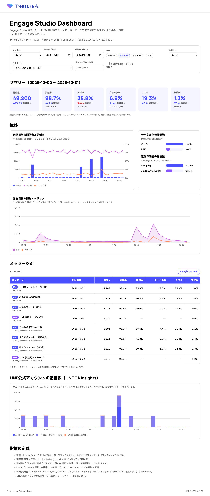
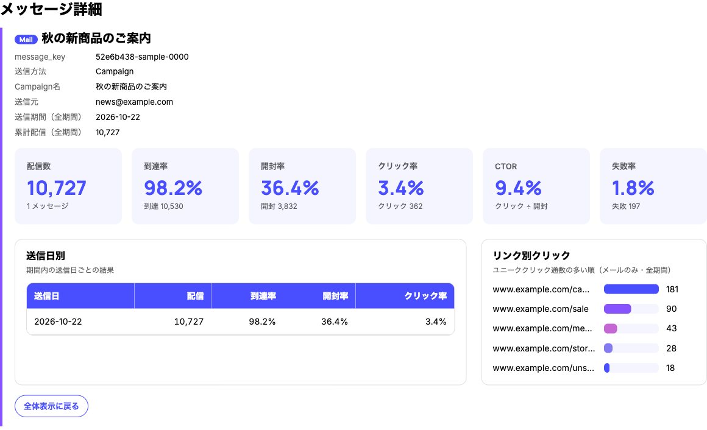

# Engage Studio Dashboard

`dashboard/template.html` は td-tas-dashboard-template（Treasure AI ブランド: `--tas-*` カラー、Manrope / Inter、公式ロゴ、「Prepared by Treasure Data」）をベースにした1ファイルの HTML ダッシュボードです。
外部 JavaScript は使わず、グラフは inline SVG です。既定では架空のサンプルデータが入っています。






## できること

- **フィルター**: チャネル（すべて / メール / LINE）、送信日（開始・終了、直近7・30・90日 / 全期間）、送信方法（Campaign / Journey・Activation）、メッセージ（単一選択）、メッセージ名の検索、Bot判定の開封・クリックを除外
- **全体**: KPI（配信数・到達率・開封率・クリック率・CTOR・失敗率。直前の同じ日数の期間と比較）、送信日別の配信数と開封率・クリック率、チャネル別・送信方法別の配信数、発生日別の開封・クリック、LINE OA Insights の日別配信数
- **メッセージ別**: 並べ替えできる一覧（配信・到達率・開封率・クリック率・CTOR・失敗率）、CSV ダウンロード
- **メッセージ詳細**（一覧の行クリック / メッセージ選択）: KPI、送信日別の結果、リンク別ユニーククリック上位10件

率は `send_cohort`（送信日 × メッセージ）を足し上げて計算するため、期間やメッセージを絞っても正しい率になります。

## ビルド

集計WFを1回以上実行したあと、Treasure Work（またはローカル）で実行します。WF の中では実行しません。

```bash
# TDから取得してビルド（tdx の認証済みプロファイル）
python3 dashboard/build_dashboard.py --db <output_db> --prefix es_ --days 400 \
  --out output/engage_studio_dashboard.html

# 取得データを保存して、あとで再ビルド
python3 dashboard/build_dashboard.py --db <output_db> --save-data output/data --out output/engage_studio_dashboard.html
python3 dashboard/build_dashboard.py --data-dir output/data --out output/engage_studio_dashboard.html
```

- 取得クエリは `dashboard/queries/*.sql`（読み取りのみ）。
- 出力HTMLには集計値と**メッセージ名（件名）**が入ります。件名に個人名・企業名が差し込まれている場合は、共有範囲に注意するか、`message_names` で表示名を付けてください。受信者アドレスは含みません。
- 共有は Treasure Work の「Publish as Web Page」（Google Apps Script）や Google Drive を使います。

## 見た目を変えるとき

- `<head>` のフォント、`:root` の `--tas-*`、ヘッダーのロゴ、フッターの表記は変更しない
- 色は `var(--tas-*)` だけ。Accent 3 は警告・マイナスだけ
- データの差し込み位置 `<script type="application/json" id="es-data">` は残す
