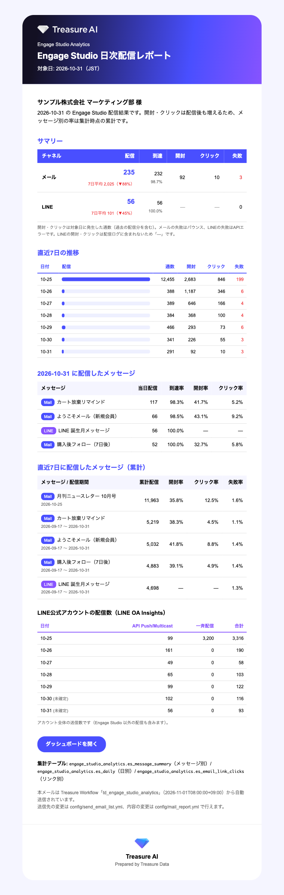

# 日次メールレポート

集計WFの最後に、**前日（実行日の前日・`tz` 基準）の配信結果**を HTML メールで送ります。
HTML はWF内の Trino クエリ（`queries/mail/build_daily_report.sql`）で部品を作り、`mail>` の
テンプレート（`templates/mail_daily_report.html`）に `${td.last_results.*}` で差し込みます。`py>` は使いません。

## 内容

| セクション | 元テーブル | 内容 |
|---|---|---|
| サマリー | `daily` | チャネル別の配信・到達・開封・クリック・失敗（前日に発生した数）と、配信数の直近7日平均との比較 |
| 直近7日の推移 | `daily` | 日別の配信数（バー）・開封・クリック・失敗 |
| 前日に配信したメッセージ | `send_cohort` | 前日に送った通の到達率・開封率・クリック率（集計時点） |
| 直近7日に配信したメッセージ | `message_summary` | 累計の開封率・クリック率・失敗率（遅れて届く開封も反映） |
| LINE OA Insights | `line_oa_daily` | `line.insights_enabled: true` のときだけ |

配色は Treasure AI ブランド（td-tas-dashboard-template の `--tas-*` と同じ HEX）。
ヘッダーは濃紺 → Primary 1（#494FFF）→ Primary 2（#8753FF）のグラデーション、表ヘッダーは Primary 1、
マイナス・警告だけ Accent 3（#EE2328）。メールクライアント向けに table + インライン CSS だけで組んでいます。

## 設定

| ファイル | 項目 |
|---|---|
| `config/mail_report.yml` | `enabled`、件名の `subject_brand` / `title`、宛名 `account_label`、`send_when_no_delivery`、`max_rows`、`dashboard_url`、`logo_url` |
| `config/send_email_list.yml` | 本番の宛先（to / cc / bcc は配列） |
| `config/test_email_list.yml` | テスト送信（`send_test_mail.dig`）の宛先 |
| `td_engage_studio_analytics.dig` | `schedule:`（既定はコメントアウト。例: 毎日 08:00） |

- `subject_brand` / `title` / `account_label` に半角のシングルクォート `'` は使わないでください（SQL 文字列に埋め込むため）。
- `logo_url` はメールから参照できる公開URL（既定は GitHub 上の白抜きロゴ PNG）。社内ポリシーで外部画像が使えない場合は自社の公開ストレージに置き換えます。
- `dashboard_url` は共有したダッシュボード（Treasure Work の Publish as Web Page / Google Drive など）のURL。空ならボタンを表示しません。

## 送信前の確認

1. `td_engage_studio_analytics.dig` を `mail_report.enabled: false` で1回実行して集計テーブルを作る
2. `config/test_email_list.yml` を自分の宛先にして `send_test_mail.dig` を実行（**メール送信を伴うので、宛先を確認してから**）
3. 表示と数値を確認したら `mail_report.enabled: true`、`send_email_list.yml` を本番宛先にして push
4. `schedule:` のコメントを外して push
